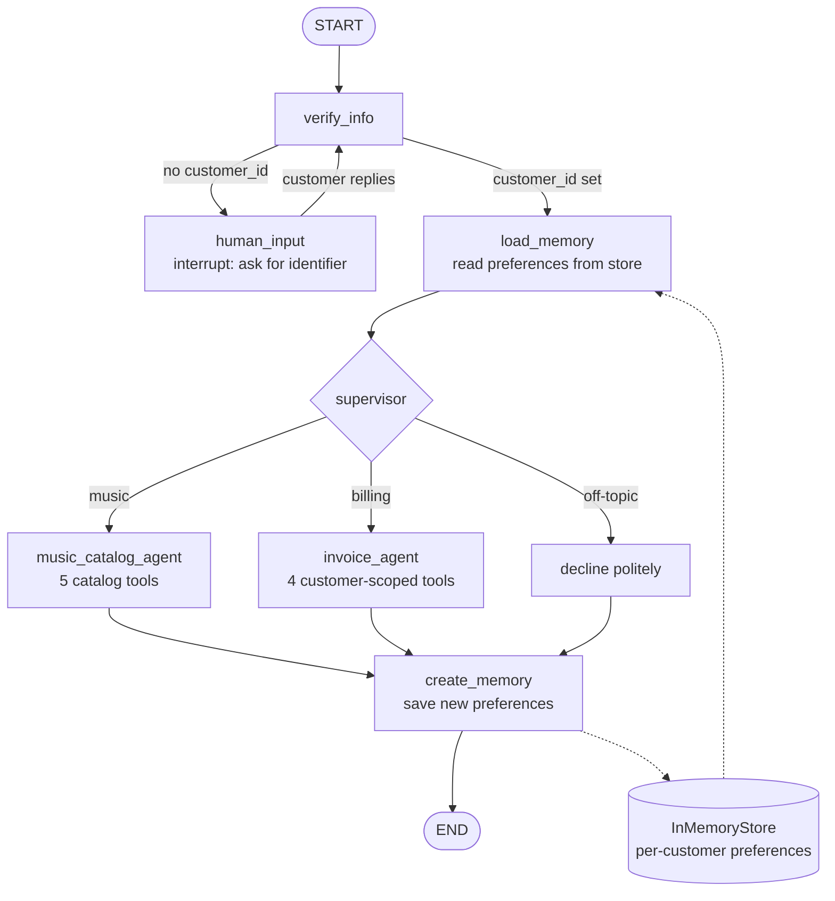

# Multi-Agent Customer Support — Digital Music Store


[](https://gradio.app)

## What This Is

A chat assistant for a digital music store, built with LangGraph. A customer first proves who
they are (Customer ID, email or phone). After that, a **supervisor** routes each question to a
**music catalog agent** or an **invoice agent**, both of which answer only from a real database
(the Chinook sample store). The assistant also **remembers each customer's music tastes** across
conversations.

## Problem Statement

A digital music store sells tracks, albums, and other media from hundreds of artists across multiple genres.

Currently, customer support is handled manually, requiring customers to contact support by email or phone to get answers to common questions, such as:

- "What rock albums are available in the catalog?"
- "Do you have any songs by AC/DC?"
- "What items were included in my most recent invoice?"
- "Who is my assigned support representative?"
- "How much have I spent in total?"

The manual support process makes it time-consuming for customers to retrieve information about the music catalog, their invoices, and their account details.

### Why it is hard

These questions involve different types of operations, and a naive implementation can lead to
inaccurate answers or security risks.

- **Catalog questions.** Questions about rock albums or AC/DC songs require searching the music
  catalog efficiently and handling large result sets without overwhelming the user.
- **Account questions.** Questions about invoices, total spending and support representatives
  involve private customer data. The assistant must verify the customer's identity and ensure
  that customers can access only their own information.
- **Accuracy matters.** Prices, invoice line items, and spending totals must be accurate. Relying on an LLM's generated responses alone can lead to fabricated or incorrect information.
- **Scope matters.** The assistant must recognize which questions are relevant to the music store and gracefully decline unrelated requests rather than generating unsupported answers.

## Quick Start

```bash
git clone https://github.com/kishorekumarl/Multi-Agent-Customer-Support.git && cd Multi-Agent-Customer-Support
python3.12 -m venv .venv && source .venv/bin/activate
pip install -r requirements.txt
cp .env.example .env    # add your OPENAI_API_KEY
python app.py           # open http://127.0.0.1:7860
```

Needs an OpenAI API key (usage is billed by OpenAI); set `OPENAI_API_BASE` to use another
OpenAI-compatible provider. The database is built in memory from
`src/database/seed_data/Chinook_Sqlite.sql` on first use, so there is nothing else to set up.
See [Configuration](#configuration-and-docker) for all settings.

## Documentation

- [Getting Started](docs/getting-started.md): install, run, Docker, other providers, first chat.
- [Architecture](docs/architecture.md): flowcharts, one turn in sequence, file-by-file map.
- [SECURITY.md](SECURITY.md) and [CONTRIBUTING.md](CONTRIBUTING.md).

## Features

- **Identity verification with human-in-the-loop.** An LLM extracts one identifier from the
  message; the database confirms it. If it can't be matched, the graph pauses (`interrupt()`)
  and asks again, then resumes with the customer's reply.
- **Secure customer ID.** The verified ID is stored in graph state and shown to agents in a
  `SystemMessage`. The invoice tools read it from state, so the model never supplies or sees a
  customer ID tool parameter, and a customer can only ever reach their own invoices.
- **Supervisor routing.** Music, billing, mixed and off-topic questions each take a different
  path (see the flow below).
- **Grounded answers.** Every prompt carries six rules: tool-only responses, exact numbers,
  honest failures, scope boundaries, no memory-based answers, and truncation transparency
  ("showing 5 of 1,309").
- **Preference memory.** Stated tastes ("I love jazz") are saved per customer with a set-union
  merge that never removes or overwrites anything; questions ("Do you have rock?") are not saved.
- **Chat UI.** Gradio chat with a status line (processing / done in X.Xs / waiting for input /
  error), instant echo of your message, and a New Conversation button. Each browser session
  gets its own conversation thread.

## Architecture

The app is a **LangGraph state machine**: identify the customer, route to a specialist agent,
then save new preferences.

### How a turn flows

1. **`verify_info`** — an LLM extracts one identifier (Customer ID, email or phone) from the
   message and the database confirms it. On a match, the customer ID is stored in graph state.
2. **`human_input`** — if there is no match, the graph pauses with `interrupt()`, asks again,
   and loops back to `verify_info` with the customer's reply.
3. **`load_memory`** — reads the customer's saved music tastes into `state["memory"]`.
4. **`supervisor`** — routes the question: music to the music agent, billing to the invoice
   agent, mixed questions to the invoice agent first and then the music agent, and off-topic
   questions are declined without calling an agent.
5. **Specialist agents** — the music agent is a hand-built ReAct loop with 5 catalog tools; the
   invoice agent uses `create_react_agent` with 4 customer-scoped tools.
6. **`create_memory`** — extracts newly stated preferences ("I love jazz") from the last ~10
   messages and merges them into the store with a set-union. Questions are not saved.



| Piece | Where | Notes |
| --- | --- | --- |
| Graph wiring | `src/graph/builder.py` | `build_graph(checkpointer, store, agent_llm)` |
| State | `src/graph/state.py` | `messages`, `customer_id`, `memory` |
| Prompts | `src/graph/prompts.py` | extraction, fallback, agents, supervisor, memory |
| Nodes | `src/graph/nodes/` | `verify_identity`, `human_input`, `load_memory`, `create_memory` |
| Agents | `src/agents/` | music (hand-built loop), invoice, supervisor |
| Tools | `src/tools/` | catalog, invoices, customer lookup, read-only SQL |
| Memory store | `src/graph/memory_store.py` | namespace `("memory_profile", customer_id)`, key `user_memory` |
| UI | `src/ui/` and `app.py` | Gradio Blocks; logic in `chat.py` is testable without a browser |

See [Design Notes and Limitations](#design-notes-and-limitations) for what the demo does not cover.

### Two kinds of memory

The **checkpointer** (`MemorySaver`) keeps one conversation's history, scoped by thread ID. The
**store** (`InMemoryStore`) keeps each customer's preferences across conversations.

## Tech Stack

| Component | Choice |
| --- | --- |
| Language | Python 3.12 |
| Agents | LangGraph, `langgraph-supervisor`, LangChain (`langchain-openai`) |
| Database | SQLite (in-memory Chinook sample) via SQLAlchemy |
| Validation | Pydantic v2 |
| UI | Gradio |
| Tests | pytest |

## Configuration and Docker

Requires Python 3.12+ and an OpenAI API key.

Set these in `.env` (see `.env.example`).

| Variable | Required | Default | Purpose |
| --- | --- | --- | --- |
| `OPENAI_API_KEY` | **yes** | — | OpenAI API key |
| `MODEL_NAME` | no | `gpt-4o` | Chat model |
| `TEMPERATURE` | no | `0.0` | Sampling temperature |
| `OPENAI_API_BASE` | no | `https://api.openai.com/v1` | OpenAI-compatible endpoint |
| `PORT` | no | `7860` | Web app port (`APP_PORT` also works) |
| `DATABASE_URL` | no | `sqlite:///:memory:` | Database (seeded at startup) |
| `LOG_LEVEL` | no | `INFO` | Logging level |
| `LOG_TOOL_PAYLOADS` | no | `true` | Log every tool's request and full JSON response (**set `false` outside local dev**; logs can contain customer data) |

Never commit `.env`. It is git-ignored and docker-ignored.

### Docker

```bash
docker build -t music-support .
docker run --rm -p 7860:7860 --env-file .env music-support
```

The key is passed at run time and is not stored in the image. If you change `PORT`, change the
`-p` mapping to match.

## Test

```bash
pytest tests/ -v
```

Tests use scripted fake models, so they need no API key and make no network calls. Add
`--cov=src` for coverage.

## Sample Usage

Customer 1 in the sample data is reachable by ID `1`, email `luisg@embraer.com.br`, or by the
phone number on file. The replies below are abbreviated; exact wording varies with the model.

```text
You:        hi
Assistant:  Sorry, I wasn't able to match that to an account. To verify your identity, please
            share your Customer ID, the email on your account, or your phone number.   [waiting]
You:        my email is luisg@embraer.com.br
Assistant:  Thanks! How can I help?
You:        What rock albums do you have?
Assistant:  Here are some rock albums ... a total of 1,309 rock tracks.   [music agent]
You:        Show me my invoices
Assistant:  Here are your invoices, showing all 7 ...                      [invoice agent]
You:        I love jazz
Assistant:  Wonderful, noted!                                              [saved to memory]
You:        suggest something for me                                       [next turn, uses it]
Assistant:  Here are some jazz tracks you might enjoy ...
You:        What's the weather?
Assistant:  Sorry, I can only help with our music store and your account.  [no agent called]
```

Click **New Conversation** to start over; you will need to verify again. Saved music
preferences stay with the customer and are loaded again once they verify.

## Project Structure

```text
app.py                          # entry point: python app.py
Dockerfile, .dockerignore, .env.example, requirements.txt
LICENSE, SECURITY.md, CONTRIBUTING.md
src/
├── agents/
│   ├── music_agent.py          # hand-built ReAct loop
│   ├── invoice_agent.py        # create_react_agent
│   ├── invoice_tools.py        # customer-scoped invoice tools (ID read from state)
│   └── supervisor.py           # routing
├── config/settings.py          # settings loaded from .env
├── database/
│   ├── connection.py, health.py
│   └── seed_data/              # Chinook_Sqlite.sql and seed.py
├── graph/
│   ├── builder.py, state.py, prompts.py, memory_store.py
│   └── nodes/                  # verify_identity, human_input, load_memory, create_memory
├── schemas/                    # Pydantic models: UserInput, UserProfile
├── tools/                      # music_catalog, invoices, customer_lookup, sql_query, _common
├── ui/                         # app.py (Gradio Blocks) and chat.py (chat logic)
└── utils/                      # logger, phone normalization
tests/
├── conftest.py                 # shared fixtures
├── unit/                       # graph, agents, nodes, tools, chat (scripted fake models)
└── test_*.py                   # health, phone, sql_query
```

## Design Notes and Limitations

- **Memory is in-process.** `MemorySaver` and `InMemoryStore` reset when the app restarts. Swap
  in a SQLite/Postgres checkpointer and store for persistence.
- **Verification happens once per conversation.** Later messages cannot switch the session to
  another customer.
- **One shared SQLite connection** serves all sessions, which is fine for a demo but not meant
  for heavy concurrent load.
- **Behavior depends on the model.** Routing and grounding are enforced by prompts and by tool
  design (scoped IDs, ownership checks), and checked by tests with scripted models plus manual
  runs against the real model.

## License and Credits

Released under the [MIT License](LICENSE).

Sample data comes from the [Chinook database](https://github.com/lerocha/chinook-database) by
Luis Rocha, used under its upstream license.
