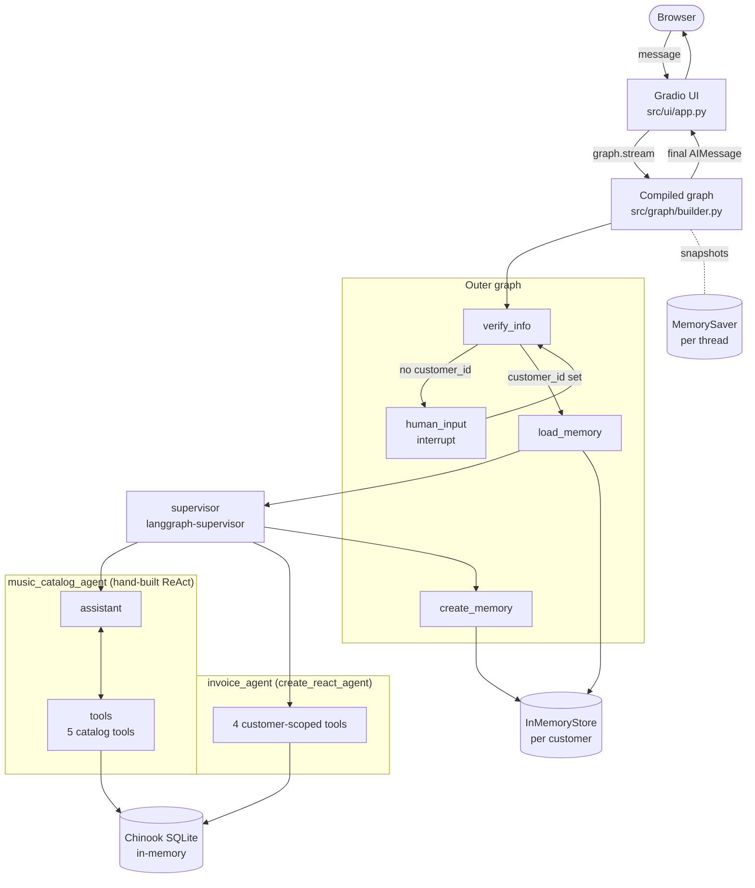
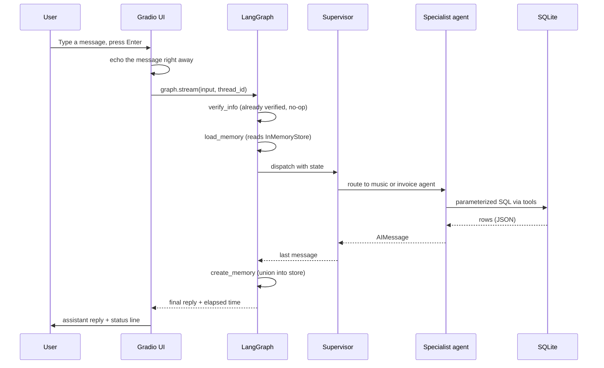
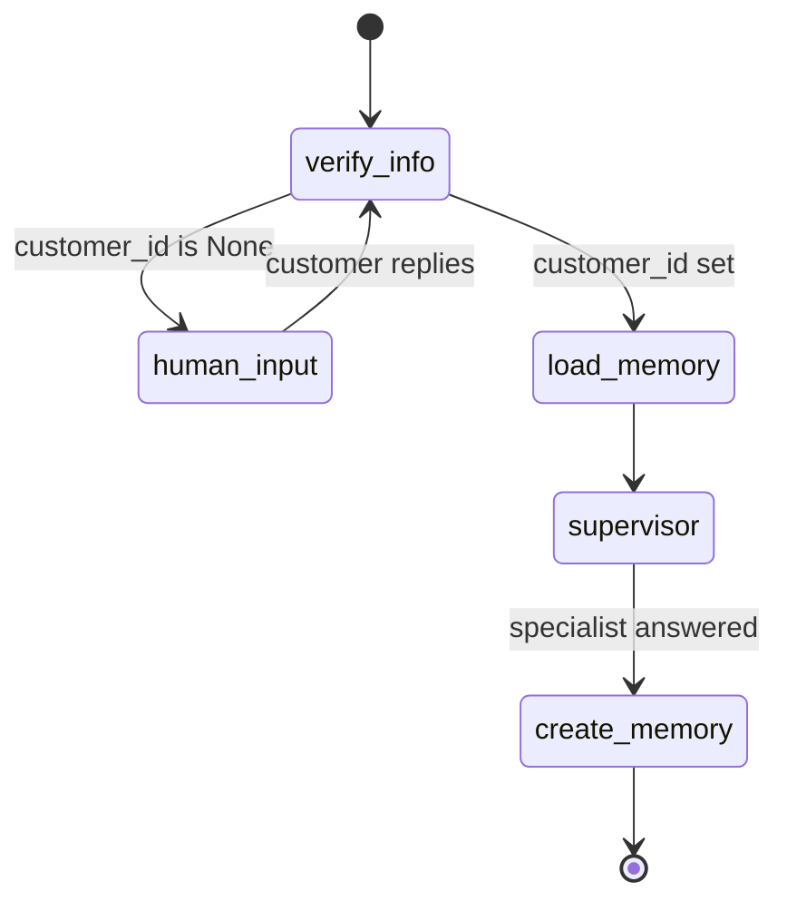
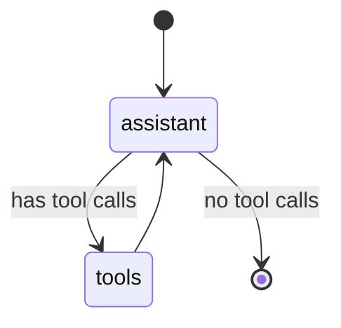

# Architecture

This document explains how the music store support assistant is wired end to end. It is written
for someone who has read the [README](../README.md) and wants to understand the moving parts well
enough to extend them.

## At a Glance

The system is a LangGraph state machine. A browser message enters the graph at `verify_info`. If
the customer is not yet identified, the graph pauses at `human_input` (an `interrupt`) until they
reply. Once a `customer_id` is set, the graph loads saved preferences, hands the question to a
**supervisor** that routes it to a music or invoice specialist, and then saves any newly stated
preferences before returning the reply to the Gradio chat UI.

Everything runs in one Python process. The database is an in-memory SQLite copy of the Chinook
sample, seeded from `src/database/seed_data/Chinook_Sqlite.sql`. The per-conversation checkpointer
(`MemorySaver`) and the per-customer store (`InMemoryStore`) are also in memory, so a restart
clears them. Swapping in persistent backends is described under [Roadmap](#roadmap).

## High-Level Flowchart

The outer graph is fixed: every turn starts at `verify_info`, and once the customer is verified the
sequence `load_memory -> supervisor -> create_memory` runs to completion before the next turn.

## Sequence: One Verified Turn

The first turn of a session differs. `verify_info` finds no identifier or no matching customer, so
the conditional edge routes to `human_input`, which calls `interrupt()` with a fallback message.
The UI detects the pause by checking `graph.get_state(config).next`, shows "Waiting for your
input", and sends the customer's next message back as `Command(resume=...)`.

## State Machine

The music specialist is a small loop of its own:

## What Lives Where

| Concern | File | Notes |
| --- | --- | --- |
| Process entry point | `app.py` | Exits with a clear message if `OPENAI_API_KEY` is missing, then launches the UI |
| Settings | `src/config/settings.py` | Reads `.env` and environment variables once |
| Logging | `src/utils/logger.py` | Shared logger; tool payload logging is controlled by `LOG_TOOL_PAYLOADS` |
| Graph state | `src/graph/state.py` | `State` (`messages`, `customer_id`, `memory`) and `AgentState` (adds the step counter) |
| Graph wiring | `src/graph/builder.py` | `build_graph(checkpointer, store, agent_llm)` and the post-verify router |
| Prompts | `src/graph/prompts.py` | Extraction, fallback, agents, supervisor, memory; one source of truth for behavior |
| Verification node | `src/graph/nodes/verify_identity.py` | LLM extracts an identifier, the database confirms it |
| Interrupt node | `src/graph/nodes/human_input.py` | Pauses and appends the customer's reply |
| Memory nodes | `src/graph/nodes/load_memory.py`, `create_memory.py` | Read and write preferences |
| Memory store helpers | `src/graph/memory_store.py` | Namespace `("memory_profile", customer_id)`, key `user_memory` |
| Supervisor | `src/agents/supervisor.py` | `create_supervisor` over the two specialists |
| Music specialist | `src/agents/music_agent.py` | Hand-built ReAct loop with the saved preferences in its prompt |
| Invoice specialist | `src/agents/invoice_agent.py` | `create_react_agent` over the scoped tools |
| Scoped invoice tools | `src/agents/invoice_tools.py` | Read the customer ID from state and check invoice ownership |
| Catalog tools (5) | `src/tools/music_catalog.py` | Albums, tracks, songs by genre, title search, track details |
| Invoice queries (4) | `src/tools/invoices.py` | Invoices, purchased tracks, support rep, line items |
| Customer lookup | `src/tools/customer_lookup.py` | Identifier to customer ID (ID, email, normalized phone) |
| Tool helpers | `src/tools/_common.py` | Input validation, parameterized queries, JSON error handling |
| Read-only SQL tool | `src/tools/sql_query.py` | Not wired into any agent (see [Trust Boundaries](#trust-boundaries)) |
| Database engine | `src/database/connection.py` | Shared engine; `StaticPool` keeps the in-memory data visible across threads |
| Seeding and health | `src/database/seed_data/seed.py`, `src/database/health.py` | Build the database, check it |
| Schemas | `src/schemas/UserInput.py`, `UserProfile.py` | Structured-output models |
| Chat logic | `src/ui/chat.py` | Streaming, status text and interrupt handling, testable without a browser |
| Gradio UI | `src/ui/app.py` | Layout, per-session thread ID, send and reset handlers |

## Trust Boundaries

The system separates three tiers:

1. **Untrusted input.** Everything in a customer's `HumanMessage`, including the identifier they
   type and every later question. Structured output on `verify_info` and parameterized SQL in the
   tools keep this content out of code paths where it could do harm.
2. **Verified state.** The `customer_id` field on `State`. It is written once, by `verify_info`,
   after a successful database lookup. The invoice tools read it from graph state through
   `InjectedState`, so the model never supplies it, and `_owns_invoice` checks that any invoice
   ID belongs to that customer.
3. **System internals.** The tools and the SQL engine. Tools are the only path from an agent to
   the database. `run_sql_query` can read every table, so it is deliberately not given to any
   agent.

If you add a tool, keep it inside these boundaries: validate typed parameters (`_parse_id`,
`_like`), and read `customer_id` from state, never from the message text.

## Architectural Invariants

- Only `verify_info` writes `customer_id`, and only once per conversation. Later messages cannot
  switch the session to another customer.
- Agents reach the database only through tools.
- `create_memory` is a set-union that matches case-insensitively. It never removes or overwrites
  saved preferences and does not write when nothing new was extracted.
- The model's own `customer_id` is ignored when saving memory. Only the extracted preferences are
  used.
- Each browser session has a UUID `thread_id` held in `gr.State`. The checkpointer is scoped per
  thread, so two concurrent users cannot see each other's conversation.
- The supervisor returns the specialist's last message (`output_mode="last_message"`).

## Concurrency and Performance Notes

- Model latency dominates response time; the SQLite queries are small by comparison.
- One shared SQLite connection serves all sessions. That is fine for a demo, not for heavy
  concurrent load. The UI queue is limited to 8 concurrent events.
- Phone matching scans the `Customer` table once, because phone formats vary. That is fine for 59
  customers; a real table would want a normalized-phone column and index.
- The checkpointer and the store are in memory, so a restart loses all state.

## Roadmap

- Replace `MemorySaver` with a SQLite or Postgres checkpointer so conversations survive restarts.
- Replace `InMemoryStore` with a persistent store for customer preferences.
- Stream tokens to the UI instead of per-node progress updates.
- Add structured logs with a correlation ID per `thread_id`, and per-tool latency metrics.
- Add per-session rate limiting at the UI boundary.
